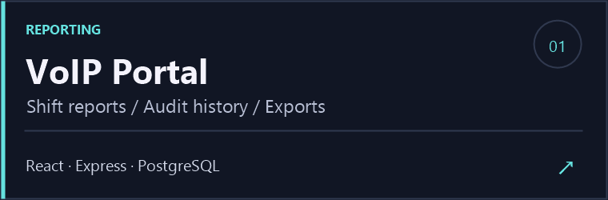
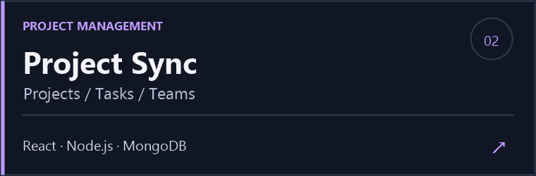
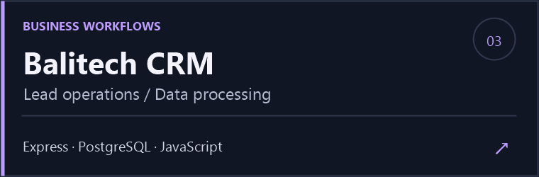
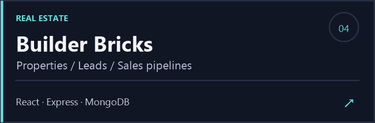

&nbsp;
&nbsp;

### Building beyond the frontend.

I'm **Shabbir Ahmed**, a full-stack developer based in **Islamabad**. I build **web applications, backend APIs, and database systems**—and handle the Linux, Nginx, and PM2 setup that brings them online.

**Available for freelance projects and full-stack / backend roles.**

## Selected builds

|  |  |
| :---: | :---: |
|  |  |

<a href="https://project-sync-five.vercel.app/">Try Project Sync</a> &nbsp; / &nbsp; <a href="https://modern-ui-sepia.vercel.app/">Frontend showcase</a> &nbsp; / &nbsp; <a href="https://github.com/shabbir28?tab=repositories">Explore all repositories →</a>

## My toolkit

<table>
<tr>
<td width="50%" valign="top">
<h3>🎨 Frontend</h3>

Interfaces people enjoy using.

<code>React</code> <code>Next.js</code> <code>TypeScript</code> <code>JavaScript</code> <code>Tailwind CSS</code>

</td>
<td width="50%" valign="top">
<h3>⚙️ Backend</h3>

The logic behind the experience.

<code>Node.js</code> <code>Express</code> <code>REST APIs</code> <code>API integrations</code>

</td>
</tr>
<tr>
<td width="50%" valign="top">
<h3>🗄️ Databases</h3>

Data that supports the workflow.

<code>PostgreSQL</code> <code>MongoDB</code> <code>Migrations</code> <code>Transactions</code>

</td>
<td width="50%" valign="top">
<h3>🚀 Deployment</h3>

From local development to live servers.

<code>Linux / Ubuntu</code> <code>Nginx</code> <code>PM2</code> <code>Git</code>

</td>
</tr>
</table>

### Have something worth building?

Let's talk about your next product, business tool, or developer role.

**[Start a conversation →](mailto:shabbirahmed.devv@gmail.com)** &nbsp; · &nbsp; [Connect on LinkedIn](https://www.linkedin.com/in/m-shabbir-ahmed-a0649928a/)
