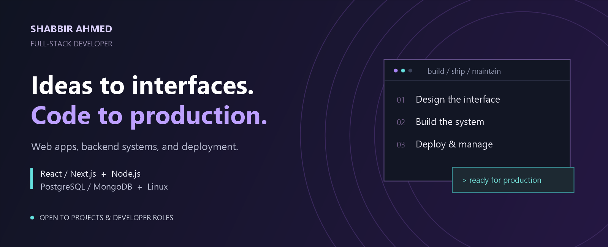
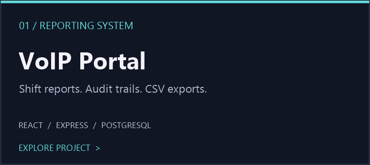
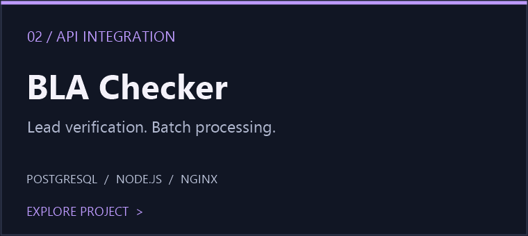
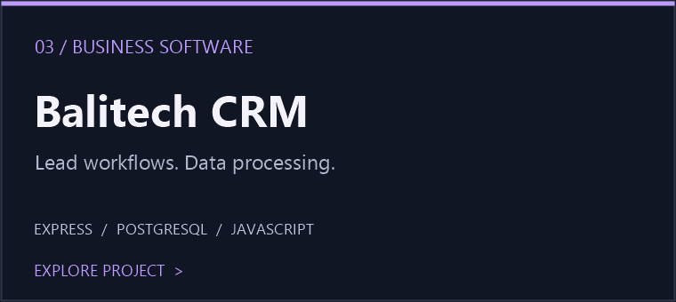
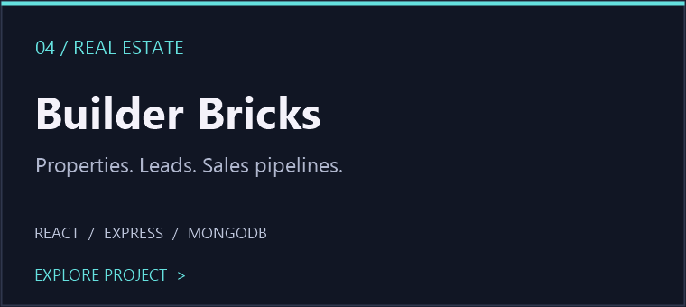

&nbsp;
&nbsp;

### Building beyond the frontend.

I'm **Shabbir Ahmed**, a full-stack developer working across **web applications, backend APIs, databases, and server deployment**. I build CRMs, reporting portals, and data-processing tools—and handle the Linux, Nginx, and PM2 setup that brings them online.

**Available for freelance projects and full-stack / backend roles.**

## Selected builds

|  |  |
| :---: | :---: |
|  |  |

<a href="https://github.com/shabbir28/project-sync">Project Sync</a> &nbsp; / &nbsp; <a href="https://modern-ui-sepia.vercel.app/">Frontend showcase</a> &nbsp; / &nbsp; <a href="https://github.com/shabbir28?tab=repositories">Explore all repositories →</a>

## My toolkit

**Interfaces**  
`React` `Next.js` `TypeScript` `JavaScript` `Tailwind CSS`

**APIs & databases**  
`Node.js` `Express` `REST APIs` `PostgreSQL` `MongoDB`

**Deployment & servers**  
`Linux / Ubuntu` `Nginx` `PM2` `Vercel` `Git`

---

### Have something worth building?

Let's talk about your next product, business tool, or developer role.

**[Start a conversation →](mailto:shabbirahmed.devv@gmail.com)** &nbsp; · &nbsp; [View my portfolio](https://personal-portfolio-one-mu-20.vercel.app/)
