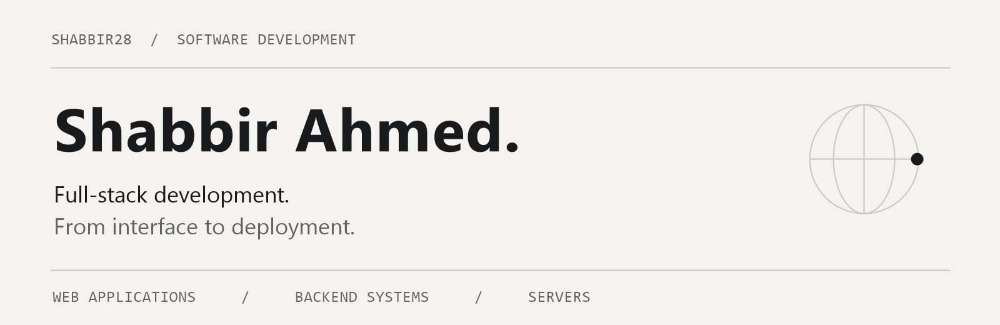

  <a href="https://personal-portfolio-one-mu-20.vercel.app/"><b>Portfolio ↗</b></a> &nbsp; · &nbsp;
  <a href="https://www.linkedin.com/in/m-shabbir-ahmed-a0649928a/"><b>LinkedIn ↗</b></a> &nbsp; · &nbsp;
  <a href="mailto:shabbirahmed.devv@gmail.com"><b>Get in touch ↗</b></a>

## About

I'm Shabbir, a **full-stack developer** building business applications, backend APIs, and database-driven systems. I work across the application lifecycle—from the interface and data model to deployment and server management.

My projects include **CRMs, reporting portals, and lead-processing tools**, using PostgreSQL and MongoDB alongside React and Node.js. I also configure Linux servers, Nginx reverse proxies, and PM2 deployments.

**Open to freelance collaborations and full-stack or backend roles.**

## Selected work

| Project | What it does | Stack |
| :--- | :--- | :--- |
| **[VoIP Portal ↗](https://github.com/shabbir28/Voip-Portal)** | Shift-based spend reporting with audit history, transactional updates, and CSV exports. | React · Express · PostgreSQL |
| **[BLA Checker ↗](https://github.com/shabbir28/BLA_Checker)** | Lead verification, local DNC matching, API integration, and batch exports. Includes server deployment configuration. | PostgreSQL · Node.js · Nginx · PM2 |
| **[Balitech CRM ↗](https://github.com/shabbir28/Balitech-crm)** | Business workflows, lead-data processing, database migrations, and CSV/XLSX exports. | Express · PostgreSQL · JavaScript |
| **[Builder Bricks CRM ↗](https://github.com/shabbir28/Builder-Bricks-CRM)** | Real-estate lead management, property listings, and sales pipelines. | React · Express · MongoDB |

[Project Sync](https://github.com/shabbir28/project-sync) &nbsp; / &nbsp; [Frontend showcase](https://modern-ui-sepia.vercel.app/) &nbsp; / &nbsp; [More repositories →](https://github.com/shabbir28?tab=repositories)

## Tools I work with

**Frontend** &nbsp; `React` `Next.js` `TypeScript` `JavaScript` `Tailwind CSS`

**Backend & data** &nbsp; `Node.js` `Express` `PostgreSQL` `MongoDB` `REST APIs`

**Deployment** &nbsp; `Linux / Ubuntu` `Nginx` `PM2` `Vercel` `Git`

## Work with me

For a project, share the problem you want to solve, the scope, and your timeline. For a role, I'd be glad to discuss how my application, backend, and deployment experience fits your team.

**[shabbirahmed.devv@gmail.com](mailto:shabbirahmed.devv@gmail.com)** &nbsp; · &nbsp; [Connect on LinkedIn](https://www.linkedin.com/in/m-shabbir-ahmed-a0649928a/)
